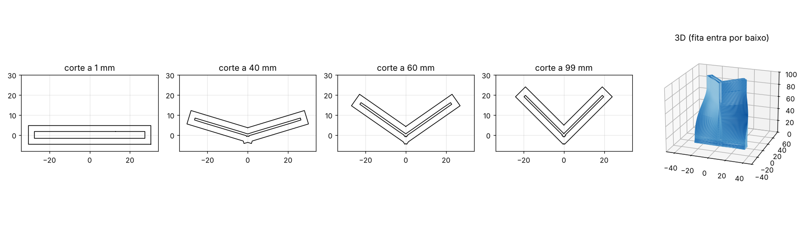

# Dobrador de fita de papel para drywall (canto 90°)

- `dobrador_fita_drywall.stl`: arquivo pronto pra imprimir
- `gerar_stl.py`: gera o STL de novo (`pip install manifold3d trimesh numpy`), com os parâmetros no topo

## Medidas
61 × 66 × 100 mm, com alça (o furo da alça serve também para pendurar no cinto ou num prego). Canal de 2 mm de folga, feito para fita de **52 mm** (dá 1,5 mm de sobra de cada lado).
Se a sua fita for de 50 ou 53 mm, mude `largura_fita` e gere de novo.

## Impressão
- Em pé, do jeito que está (boca plana na mesa). Não precisa de suporte.
- PETG é melhor que PLA (a fita esquenta e desgasta menos o PETG). Camada de 0,2 mm, 3 perímetros, 20 % de preenchimento.
- Lixe de leve a boca de saída se ficar áspera, senão ela arranha o papel.

## Uso
Enfie a ponta da fita plana pela boca larga (embaixo), empurre até sair em V do outro lado e puxe.
O vinco central de fábrica da fita tem que ficar alinhado no meio do canal.
